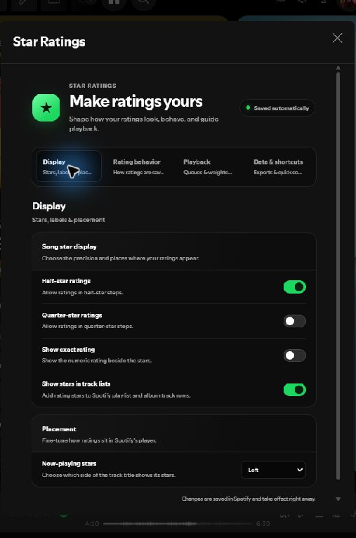
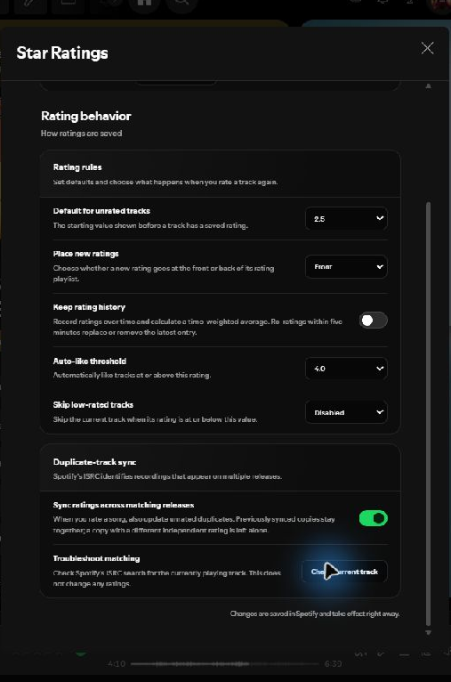

# Spicetify Star Ratings

Add and manage personal star ratings in Spotify with Spicetify.

> This is an actively maintained fork. See [Project history](#project-history)
> for the original projects this work builds on.

## Install

1. Install [Spicetify](https://spicetify.app)
2. Install "Star Ratings" from the Marketplace
   

## What's new in this fork

- Album ratings appear under the album name and average only the songs you
  have rated.
- Album averages are saved locally, so a previously calculated value is ready
  on later visits without repeatedly requesting album data from Spotify.
- Album stars always show quarter-star precision: an average of **4.25** fills
  one quarter of the fifth star, rather than rounding it to a half star.
- Existing song-rating settings are retained, including the optional
  quarter-star input mode.
- Optional Album of the Year critic or user scores on album pages, plus album
  and artist links in Spotify's three-dot menus.

## Screenshots

## Settings

Open **Star Ratings** from Spotify's profile menu. Settings are grouped into
Display, Rating behavior, Playback, Data & shortcuts, and AOTY, and changes
save automatically.

### Duplicate-track sync

When enabled, rating a Spotify track also rates unrated releases with the same
ISRC. A matching release that already has a different latest rating is left
alone; copies that still share the source track's latest rating continue to be
updated together. Local files are not included because they do not have
Spotify ISRCs.

The **Check current track** button runs the same Spotify ISRC lookup without
changing ratings and reports any other matching releases. It distinguishes
Spotify finding only the current track from returning no tracks for that ISRC.

### Album of the Year (AOTY)

The **AOTY** settings tab can show an album's critic or user score below your
personal album stars, formatted out of 100 (for example, **93/100**). It can
also add **Open album in AOTY** and **Open artist in AOTY** to the matching
Spotify three-dot menus. Each feature is independently opt-in.

Without a Parse key, score lookup uses the no-key community [AOTY API](https://aoty.prigoana.com/).
You can optionally add a Parse API key from your [Parse settings page](https://parse.bot/settings)
in the AOTY settings tab. When a key is saved, Parse is tried first for album
matching and score details; the community API remains a fallback. Album menu
links use the exact page found by the score lookup when available. The
**Test key** button checks both album search and score details.
The key is stored in local Spicetify storage and sent only to Parse in its
`X-API-Key` header; it is not part of settings or rating exports. Lookups send
the public album title and artist name(s), not Spotify account data. A normal
uncached lookup uses two Parse credits (search and score details); if title-only
search cannot identify a match, one combined-query retry may use one extra
credit. Results are cached in memory. If
both sources are unavailable, the extension shows that the score could not be
loaded; album menu links reuse the matched page when available and otherwise
open AOTY search. Artist menu links open AOTY search. A missing critic or user
score is not substituted with the other score.

## Implement List

- [x] option to play songs with a minimum rating
- [x] option to play only unrated songs
- [x] option to play songs weighted by ratings
- [x] configurable weighting (linear/exponential)
- [x] creating weigthed playlist
- [x] rating averaging over time
- [x] album ratings averaged from rated songs
- [] ratings for local files
- [] ratings for playlists option (maybe)
- [x] optional AOTY critic/user score on album pages
- [x] optional AOTY album and artist links in Spotify context menus

## Weighted Playback
- Always keeps one weighted random track in queue.
- Workaround for remote-play issues can be enabled in the settings.

## Weighted Playlist
- Create a weighted version of a Playlist.
- Contains N random items from the original Playlist, weighted by their ratings.
- Can be used as an 'offline' weighted playback.

## Average Ratings
This has the purpose of making ratings more closely reflect your tastes;
Instead of only keeping the latest rating, every rating is recorded.
The canonical rating (used for display and random sampling) is calculated using a time-weighted average of all historical ratings.

As a safeguard and to allow ad-hoc changes of mind, any re-ratings within a five minute window behave like a non-averaged rating:
If the new rating is the same as the old one, the old rating is removed. If they are different, the new rating replaces the old one.

## Album Ratings

On an album page, the extension shows an album rating below the album name.
It is the average of the canonical ratings for the album's rated songs only;
unrated songs do not count. Albums with no rated songs do not show an album
rating.

The calculated value is cached locally in Spicetify storage and is refreshed
when the album's rated rows render or a rating changes. This keeps the rating
available on later visits without making album-page network requests.

Album averages are rounded to the nearest quarter star and always use the
quarter-filled star artwork. This is independent of the song-rating precision
chosen in Settings.

## Star Rating Playlist Images

<table>
    <tr>
      <td></td>
      <td></td>
      <td></td>
    </tr>
    <tr>
      <td></td>
      <td></td>
      <td></td>
    </tr>
    <tr>
      <td></td>
      <td></td>
      <td></td>
    </tr>
    <tr>
      <td></td>
      <td colspan="3"></td>
    </tr>
  </table>

 

## Playlist Icons Recommendation

https://github.com/jeroentvb/spicetify-playlist-icons provides a nice view of the playlist icons when you are adding to them manually 

## It Doesn't Work!
Please [open an issue](https://github.com/arionukshini/spicetify-star-ratings/issues/new)
with your Spotify and Spicetify versions, plus a screenshot if possible.

## Performance
The cost of adding a new rating scales with the size of the playlist the song is being added to. 
So if you have a _lot_ of ratings, it may be beneficial to keep your currently active playlists decently small. To do this, you can adjust the `Max Playlist Items` in the settings, which automatically creates new playlists when the limit is reached.

## Project history

- This maintained fork: [arionukshini/spicetify-star-ratings](https://github.com/arionukshini/spicetify-star-ratings)
- Working upstream fork: [brimell/spicetify-star-ratings](https://github.com/brimell/spicetify-star-ratings)
- Original archived project: [Duffey's Spicetify Star Ratings](https://github.com/duffey/spicetify-star-ratings)

## Credits

This project builds on Duffey's original extension and brimell's working fork.

*This extension was built with [Spicetify Creator](https://github.com/spicetify/spicetify-creator)*
